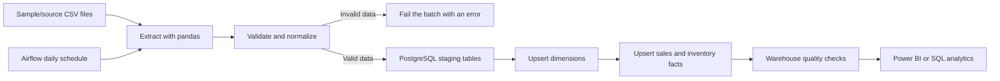

# E-commerce Analytics & Data Intelligence Platform

A learning project that demonstrates the design and implementation of a small
batch data platform. It reads synthetic CSV data, validates and transforms it,
loads a PostgreSQL star-schema warehouse, and can schedule the run with Apache
Airflow. The warehouse is designed to be consumed by Power BI.

> **Scope:** The working ingestion source is CSV. This repository does not yet
> connect to a live commerce API, scrape a website, stream inventory changes in
> real time, or include a finished Power BI `.pbix` report. The Airflow schedule
> is daily; inventory is loaded as dated snapshots.

## What the pipeline does



The loader uses source business IDs and PostgreSQL `ON CONFLICT` upserts, so
re-running an unchanged input updates the same dimension/fact rows rather than
duplicating them. Dimension, fact, and quality-check SQL lives in `sql/`.
Every run saves the latest source CSVs directly to `data/raw/` and transformed
dimension/fact CSVs directly to `data/processed/`, using stable file names.
Each file includes a `batch_id`; raw files also include a UTC ingestion
timestamp. A new run overwrites the previous output, so these folders show one
clean, current run rather than a growing list of batch folders. The data files
are Git-ignored so local or sensitive data is not accidentally committed.

## Repository map

| Path | Purpose |
|---|---|
| `src/ingestion/` | CSV readers for sales, products, and customers |
| `src/transformation/` | Sales, inventory, dimension, and calendar transforms |
| `src/validation/` | Required-column, null, uniqueness, and relationship checks |
| `src/warehouse/` | PostgreSQL staging, warehouse loads, and final checks |
| `src/pipeline.py` | End-to-end command-line ETL entry point |
| `dags/ecommerce_etl_dag.py` | Daily Airflow DAG that runs the pipeline |
| `sql/schema.sql` | Creates PostgreSQL schemas and warehouse tables |
| `sql/dimensions.sql`, `sql/facts.sql` | Idempotent warehouse upserts |
| `data/sample/` | Synthetic CSV inputs (10,000 sales lines by default) |
| `data/generate_sample_data.py` | Reproducible generator for larger source datasets |
| `data/raw/`, `data/processed/` | Latest raw and transformed CSV outputs |
| `docs/` | Requirements, architecture, model, ETL, dashboard, and work plan |
| `tests/` | Unit tests for validation and transformations |

## Run order (Windows with Docker Desktop)

The Docker setup runs PostgreSQL and a development Airflow instance. PowerShell
commands below assume the current directory is this project folder.

1. **Create local configuration and Python environment.**

   ```powershell
   Copy-Item .env.example .env
   py -3.11 -m venv .venv
   .\.venv\Scripts\Activate.ps1
   python -m pip install --upgrade pip
   pip install -r requirements.txt
   ```

   The Docker warehouse publishes on host port `5433` by default to avoid
   colliding with a locally installed PostgreSQL server on `5432`. Keep
   `POSTGRES_PORT` and the port in `DATABASE_URL` aligned. Edit `.env` before
   starting services if the default local database password needs to change.
   Do not commit `.env`.

2. **Generate larger synthetic inputs.** The checked-in sample files are
   generated reproducibly by default with 10,000 sales, 250 products, 1,000
   customers, 20 regions, and 5,000 inventory snapshots:

   ```powershell
   python .\data\generate_sample_data.py
   ```

   Adjust the volume if needed:

   ```powershell
   python .\data\generate_sample_data.py --sales-rows 50000 --products 500 --customers 5000 --regions 20
   ```

   This overwrites the synthetic CSV inputs in `data/sample/`. The ETL
   overwrites the latest CSV files directly in `data/raw/` and
   `data/processed/` on every run.

3. **Start PostgreSQL and Airflow.**

   ```powershell
   docker compose up --build -d
   docker compose ps
   ```

   The Airflow image installs dependencies using the matching Airflow 2.10.5
   constraints; do not remove that constraint during image customization.
   Airflow runs in development mode with a sequential executor and SQLite
   metadata. The DAG separates extraction, validation/transformation,
   dimension loading, fact loading, and quality checks into visible tasks.
   The warehouse itself uses PostgreSQL. This setup is intended for learning,
   not production deployment.

4. **Initialize the warehouse schema.** Run this once for a new PostgreSQL
   volume:

   ```powershell
   docker compose exec warehouse psql -U ecommerce_app -d ecommerce_warehouse -f /sql/schema.sql
   ```

   If you changed the database name or user in `.env`, use those values in the
   command. Re-running `schema.sql` is safe because it uses
   `CREATE ... IF NOT EXISTS`.

5. **Run the ETL directly once.** This uses the host URL in `.env` and is a
   convenient way to see errors and the batch summary:

   ```powershell
   python -m src.pipeline
   ```

   To read a different input directory:

   ```powershell
   python -m src.pipeline --data-dir data/sample
   ```

   The input directory must contain `sales_sample.csv`,
   `products_sample.csv`, `customers_sample.csv`, `regions_sample.csv`, and
   `inventory_sample.csv`.

6. **Run the Airflow-scheduled copy.** Open <http://localhost:8080>, find
   `ecommerce_data_platform`, enable it, and trigger a run. `airflow standalone`
   creates a local UI account and prints the generated login information in
   its startup logs:

   ```powershell
   docker compose logs airflow
   ```

7. **Check the warehouse and tests.**

   ```powershell
   docker compose exec warehouse psql -U ecommerce_app -d ecommerce_warehouse -c "SELECT COUNT(*) FROM warehouse.fact_sales;"
   python -m pytest -q
   ```

   To stop the services without deleting the database volume:

   ```powershell
   docker compose down
   ```

### Run against an existing local PostgreSQL

Install PostgreSQL separately, create the configured database and role, then
initialize the schema. For a separately installed server on port `5432`, set
`POSTGRES_PORT=5432` and update `DATABASE_URL` to use port `5432` in `.env`:

```powershell
psql -h localhost -U ecommerce_app -d ecommerce_warehouse -f .\sql\schema.sql
python -m src.pipeline
```

Airflow is optional for a one-off run. On Windows, use Docker/WSL2 for Airflow
rather than trying to run its scheduler natively.

## Data contracts and measures

- `fact_sales` grain: one row per source sales line. Net sales is
  `quantity * unit_price - discount_amount`, where discount is a line amount.
- `fact_inventory` grain: one product-region-date stock snapshot. `stock_value`
  is `available_quantity * unit_cost`.
- `dim_date`, `dim_product`, `dim_customer`, and `dim_region` provide the
  descriptive attributes used by both facts.
- A source row with missing/invalid required values, a duplicate source key, or
  an unknown dimension key fails before warehouse writes begin. The database
  transaction rolls back if a load or post-load quality check fails.
- Raw extracts are saved after all source files are read; processed snapshots
  are saved after validation and transformation and before the database load.
  A database failure therefore leaves the CSV snapshots available for
  troubleshooting.

See `docs/data_model.md` and `docs/data_dictionary.md` for the fuller design.

## Power BI deliverable

A `.pbix` is not required by the assignment's explicit documentation
deliverables (which ask for dashboard requirements/mockups), but it is
recommended if you need to demonstrate the suggested e-commerce project as a
working analytics platform. Connect Power BI Desktop to PostgreSQL and build
at least the Sales Overview and Inventory Monitoring pages described in
`docs/dashboard_mockups.md`.

## Development checks

```powershell
python -m pytest -q
```

The tests cover required-field validation, sales net-value logic, inventory
valuation, uniqueness checks, and date dimension keys. Full integration
verification requires a running PostgreSQL instance and initialized schema.

## Security and operations

- Use synthetic/local inputs for this exercise. Do not commit `.env`, real
  customer data, or credentials.
- Change the sample password before exposing any service outside localhost.
- The Compose Airflow service uses development settings and generated local
  credentials; do not expose it publicly.
- API ingestion, quarantine exports, run-history persistence, production-grade
  Airflow metadata storage, and Power BI publishing are follow-up work.
