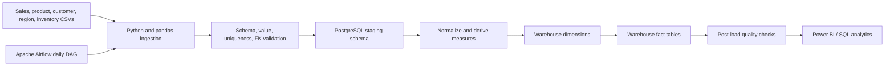

# Architecture

## Components
1. **Sources:** the current runnable inputs are synthetic CSV files. API and
   operational database connectors are future extensions.
2. **Ingestion:** pandas reads CSVs as strings so type conversion is deliberate
   and invalid values are caught during transformation.
3. **Validation and transformation:** required columns, nulls, numeric/date
   rules, unique business keys, and foreign keys are checked before opening
   the warehouse transaction.
4. **Staging:** source rows are written to PostgreSQL `staging` tables inside
   the transaction.
5. **Warehouse:** `warehouse` contains conformed dimensions and sales and
   inventory facts. SQL upserts use source business keys for idempotent reruns.
6. **Orchestration:** Airflow schedules the end-to-end Python pipeline daily
   and retries transient failures.
7. **Serving:** SQL clients or Power BI can query the warehouse. Dashboard
   layouts are specified, but no PBIX is included.

## Environment and security
The Docker Compose setup is for local learning: PostgreSQL stores the
warehouse, while Airflow standalone uses a local SQLite metadata database and
SequentialExecutor. Configure secrets through `.env`; do not commit credentials
or expose the development Airflow UI publicly.

## Future production extensions
Use an API/OLTP-specific extractor, durable batch metadata, quarantined bad
records, production-grade Airflow metadata storage and executor, monitoring,
and incremental/streaming inventory ingestion if the business requires
real-time stock visibility.
