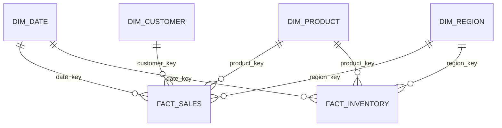

# Data Model

## Fact grains
- `warehouse.fact_sales`: one row per unique source sales line.
- `warehouse.fact_inventory`: one row per product, region, and snapshot date.

## Dimensions
- `dim_date`: integer `YYYYMMDD` key and calendar attributes.
- `dim_product`: warehouse surrogate key plus unique source `product_id`.
- `dim_customer`: warehouse surrogate key plus unique source `customer_id`.
- `dim_region`: warehouse surrogate key plus unique source `region_id`.

The fact tables reference warehouse surrogate keys; source IDs remain in the
dimension tables for traceability. The current model updates dimension
attributes in place. It does not implement slowly changing dimension history.

## Measures
- `sales_amount = quantity * unit_price - discount_amount`. The discount is a
  line-level value, not a per-unit value.
- `stock_value = available_quantity * unit_cost`.

Run `sql/schema.sql` to create the schemas, tables, constraints, and indexes.
