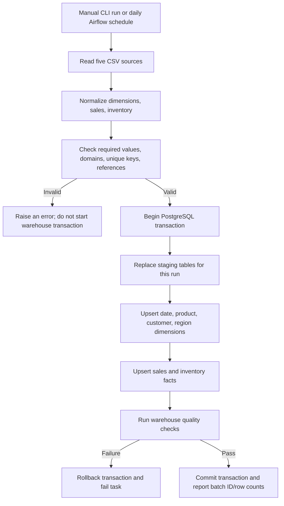

# ETL Flow

## Current implementation
`python -m src.pipeline` reads `sales_sample.csv`, `products_sample.csv`,
`customers_sample.csv`, `regions_sample.csv`, and `inventory_sample.csv`.
Validation occurs before warehouse writes; staging, dimension/fact upserts, and
post-load checks share a single transaction. A failure during loading or the
final checks rolls the transaction back.

The Airflow DAG wraps the complete run in one retryable task. This keeps the
transaction boundary simple; the DAG does not yet expose every ETL stage as a
separate Airflow task.

## Failure behavior
Missing files, malformed values, duplicate business keys, and unknown
dimension references raise explicit errors. Invalid rows are not silently
dropped. Durable quarantine storage and persistent batch-history tables are
not yet implemented.
