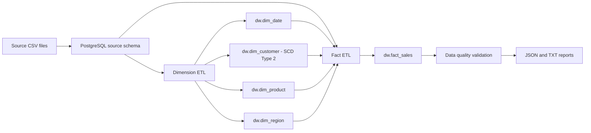
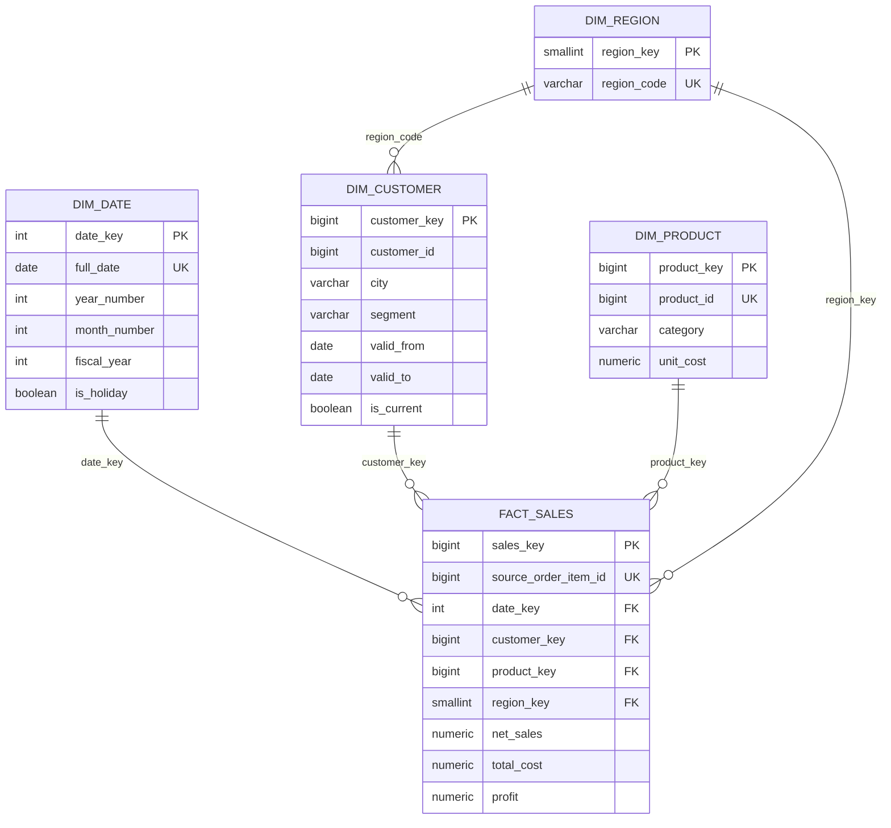

# Day 24 Warehouse Architecture

## Data flow

## Star schema and fact grain

`dw.fact_sales` is the central fact table. Its grain is **one source order item / order line**. An order containing three products produces three fact rows. `order_id` is retained as a degenerate dimension for drill-through and transaction-level analysis.

## Slowly changing dimension strategy

- Customer: **SCD Type 2**. Changes to name, email, location, region, or segment expire the active row and insert a new surrogate-key version. The validity end date is inclusive; a new version begins the next effective date.
- Product: **SCD Type 1**. Product attributes are overwritten on change. Cost and price used by already-loaded sales facts are copied into the fact row, preserving the historical transaction measure.
- Region: Type 1 upsert.
- Date: generated calendar dimension, refreshed for the source order-date range plus one year on both sides.

## Measure definitions

- `gross_sales = quantity × unit_price`
- `discount_amount = gross_sales × discount_pct`
- `net_sales = gross_sales − discount_amount`
- `total_cost = quantity × product unit_cost`
- `profit = net_sales − total_cost`

The pipeline rounds monetary measures to two decimal places. `discount_pct` is stored as a fraction (for example, `0.10` means 10%).

## Date conventions

The fiscal year starts on 1 April. For example, April 2025–March 2026 is FY2026. `is_holiday` is populated from `source.holidays`; the packaged records are a small India national-holiday demonstration calendar, not a complete operational holiday service. Add local / state / country holiday dates to the source table before refreshing the date dimension.
