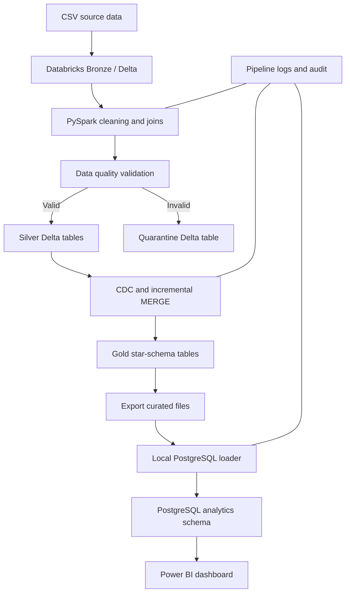

# Day 24 — E-Commerce Data Transformation & Incremental Processing

A self-contained Data Engineering project demonstrating PySpark transformations, reusable data-quality checks,
incremental CDC processing, error recovery, PostgreSQL serving tables, and Power BI reporting.

## Architecture



## Project layout

- `databricks/`: Databricks notebook source files. Import each `.py` file as a notebook or paste it into a notebook.
- `src/`: local data generation, validation, CDC helpers, PostgreSQL loading, logging and retry utilities.
- `sql/`: PostgreSQL schema and validation queries.
- `tests/`: unit tests plus an opt-in PostgreSQL integration test.
- `powerbi/`: dashboard layout and DAX measures.
- `data/`: generated source and CDC CSV files.

## 1. Prerequisites

- Databricks workspace with a Spark-enabled cluster and Delta Lake support.
- Python 3.10+ on Windows.
- PostgreSQL 17 and pgAdmin / DBeaver.
- Power BI Desktop.
- Git (recommended).

Databricks Free Edition capabilities and networking restrictions can differ from paid workspaces. The notebook uses standard Spark/Delta APIs; validate that your workspace supports the required compute and Delta operations.

## 2. Generate sample data locally

From PowerShell, in the project root:

```powershell
py -3.11 -m venv .venv
.\.venv\Scripts\Activate.ps1
python -m pip install -r requirements.txt
python .\src\generate_data.py --output .\data --orders 5000 --seed 42
```

Use a standard (GIL-enabled) Python installation for this environment. On Windows, `py -m venv` may select a free-threaded Python build, which may not have prebuilt pandas and NumPy wheels. If `.venv` was created with that build, recreate it with the explicit Python version above before installing dependencies.

The generator creates:
- `customers.csv`
- `products.csv`
- `regions.csv`
- `orders.csv` (one row per order line)
- `order_changes.csv` (CDC sample with I/U/D operations)

The CDC file contains deterministic inserts, updates and deletes. It is deliberately separate from the initial snapshot.

## 3. Create Databricks tables

Upload the generated CSV files to a location accessible by Databricks, such as a Unity Catalog Volume or DBFS location.
For example, configure the notebook widget `source_path` to `/Volumes/<catalog>/<schema>/<volume>/day24`.

Run the notebooks in this order:

1. `databricks/00_environment_setup.py`
2. `databricks/01_bronze_ingestion.py`
3. `databricks/02_silver_transformations.py`
4. `databricks/03_data_quality.py`
5. `databricks/04_incremental_cdc.py`
6. `databricks/05_gold_aggregations.py`
7. `databricks/06_export_gold.py`

The notebooks create `bronze`, `silver`, `gold`, and `ops` schemas in the selected catalog. The setup notebook uses widgets for catalog, schema and source path. Update those values for your workspace.

### Notebook execution notes

- Run the initial snapshot ingestion and Silver/Gold build before the CDC notebook.
- CDC is applied to `silver.orders_current` using `order_changes.csv`.
- `MERGE` handles inserts and updates; a `D` operation deletes the matching order-line key.
- The notebook writes invalid records to `silver.quarantine_orders` and quality metrics to `ops.data_quality_results`.
- The export notebook writes CSV files into `export_path` for the local PostgreSQL loader.

## 4. Create PostgreSQL serving tables

Open `sql/01_create_analytics_schema.sql` in pgAdmin Query Tool and execute it against your existing PostgreSQL 17 database (for example, `ecommerce_practice`).

Set connection details in `.env` (copy `.env.example` to `.env`). Never commit `.env`.

```powershell
Copy-Item .env.example .env
```

Edit `.env` with your local PostgreSQL host, port, database, username and password.

## 5. Load Gold outputs into PostgreSQL

Download/copy the exported Gold CSV files from Databricks into `data/gold_export/`. The expected files are:

- `dim_customer.csv`
- `dim_product.csv`
- `dim_region.csv`
- `dim_date.csv`
- `fact_sales.csv`

Then run:

```powershell
python -m src.postgres_loader --input-dir .\data\gold_export
```

The loader uses PostgreSQL `INSERT ... ON CONFLICT DO UPDATE` for dimensions and facts, and commits the load in a transaction. It loads dimensions before facts.

**Delete propagation:** the Databricks CDC notebook physically removes deleted order lines from the current Silver table and rebuilds Gold. The exported `fact_sales.csv` is a full current-state snapshot. The PostgreSQL loader synchronizes the fact table to that snapshot by deleting target fact rows not present in the incoming export, then upserting incoming rows. This makes deletes visible downstream. For large production systems, replace snapshot synchronization with a durable delete-event/tombstone stream.

## 6. Run tests

```powershell
pytest -q
```

The PostgreSQL integration test is skipped unless `RUN_POSTGRES_INTEGRATION=1` is set and valid `.env` credentials are supplied.

## 7. Power BI

1. Open Power BI Desktop.
2. Select **Get data → PostgreSQL database**.
3. Server: `localhost:5432` (or your configured host/port).
4. Database: your PostgreSQL database, e.g. `ecommerce_practice`.
5. Select Import mode initially.
6. Select tables from the `analytics` schema.
7. Create relationships:
   - `dim_customer[customer_key]` → `fact_sales[customer_key]`
   - `dim_product[product_key]` → `fact_sales[product_key]`
   - `dim_region[region_key]` → `fact_sales[region_key]`
   - `dim_date[date_key]` → `fact_sales[date_key]`
8. Use the DAX measures in `powerbi/measures.dax`.

Recommended report pages and visuals are documented in `powerbi/dashboard_guide.md`.

## 8. Important implementation boundaries

- This is a learning implementation with simulated CDC, not a production database-log CDC connector.
- `updated_at` and the change-file operation code are used as source change metadata.
- The local PostgreSQL loader runs on your Windows machine because a cloud Databricks cluster cannot reach `localhost` on your PC without a secure network path.
- Email alerts are represented by an optional SMTP helper. Configure SMTP environment variables only if you want to test email delivery.
- For production, add secrets management, schema evolution policy, orchestration, data retention, access controls, monitoring and idempotent run identifiers.

## Deliverables checklist

- [x] PySpark transformation notebooks
- [x] Reusable data quality framework and quarantine
- [x] Incremental CDC with insert/update/delete handling
- [x] Retry, logging and optional email alert utilities
- [x] PostgreSQL serving schema and idempotent loader
- [x] Unit and integration test examples
- [x] Power BI dashboard plan and DAX library
