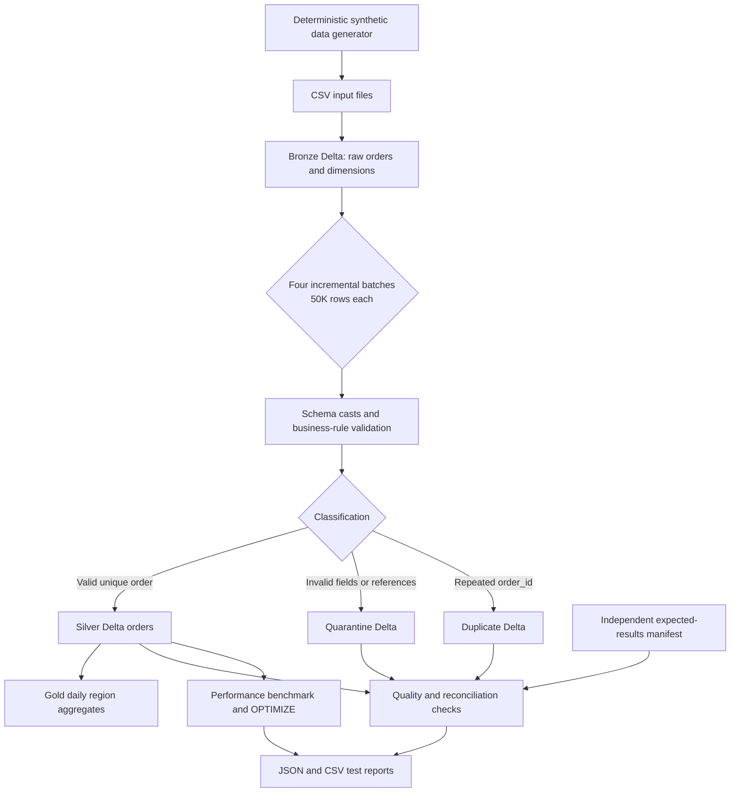

# Architecture — Day 27 Databricks Pipeline Testing

## Logical flow

## Layer responsibilities

| Layer | Contents | Main responsibility |
|---|---|---|
| Input | CSV files | Portable deterministic synthetic source data |
| Bronze | Raw orders and dimensions in Delta | Preserve source values and provide repeatable reads |
| Silver | Validated unique orders | Typed, quality-checked business records |
| Quarantine | Rejected source events | Preserve invalid rows and rejection reasons |
| Duplicate | Repeated source events | Preserve duplicate rows without polluting Silver |
| Gold | Daily and regional aggregates | Analytics-ready order, customer and revenue measures |
| Reports | JSON and CSV outputs | Evidence for quality, reliability and performance testing |

## Keys and semantics

- `source_row_id` uniquely identifies a row/event in the delivered CSV dataset.
- `order_id` is the business key and must be unique in Silver.
- Duplicate rows have a new `source_row_id` but repeat an existing `order_id`.
- `batch_id` assigns every raw row to one of four ingestion batches.
- `expected_manifest.csv` is a test oracle. It must not be joined into the pipeline before classification.

## Reconciliation invariant

For this dataset, every input source row must be classified exactly once:

\[
N_{raw} = N_{valid} + N_{rejected} + N_{duplicate}
\]

The expected-results comparison also checks that the pipeline's classification agrees with the independent manifest.
